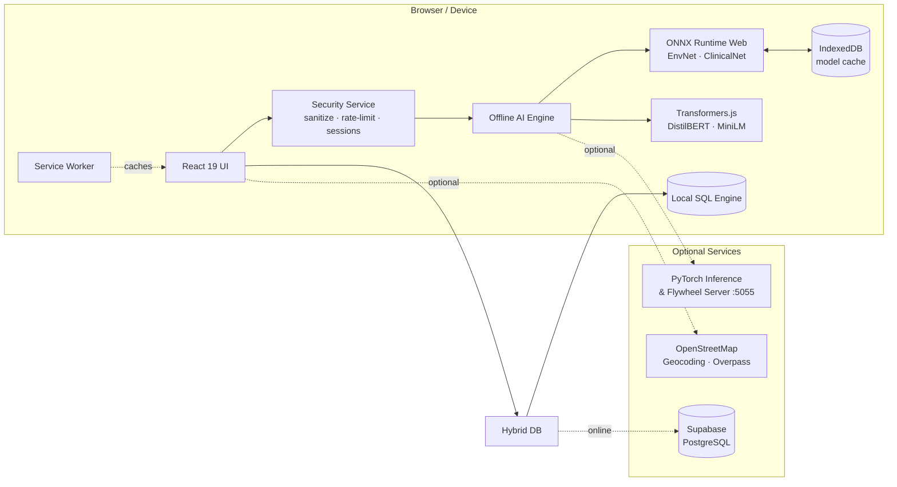

<div align="center">


# GeoSick AI

### Environmental Health Intelligence — Private, Offline-First, On-Device

Turning environmental signals and personal symptoms into clear, actionable health guidance, with the AI running directly in the browser.


[**Live Demo**](https://geo-ai-sick.netlify.app/) · [**Demo Video**](https://drive.google.com/file/d/148WkEs5q4xNxiGtGiPqv5eBKiaxINeaY/view?usp=sharing) · [**Pitch Video**](https://drive.google.com/file/d/1diBm7q2Tng0WmBi7MyqA4i59zLHtFKEr/view?usp=sharing) · [**Slide Deck**](https://docs.google.com/presentation/d/1awHopDbwPQem9vXrC6NDtS9IPT9znbVL/edit?usp=sharing&ouid=110699750221044459184&rtpof=true&sd=true)

</div>

---

## Table of Contents

- [Overview](#overview)
- [The Problem](#the-problem)
- [Our Approach](#our-approach)
- [Features](#features)
- [System Architecture](#system-architecture)
- [AI Models](#ai-models)
- [Tech Stack](#tech-stack)
- [Getting Started](#getting-started)
- [Configuration](#configuration)
- [Training Pipeline](#training-pipeline)
- [Project Structure](#project-structure)
- [Privacy & Security](#privacy--security)
- [Roadmap](#roadmap)
- [Medical Disclaimer](#medical-disclaimer)

---

## Overview

**GeoSick AI** is a health intelligence platform that connects a person's surroundings to their wellbeing. Users can photograph an area to spot hazards, describe their symptoms, read a prescription, check in on their mental health, and explore health risks on a 3D globe.

Most health AI apps send images and symptoms to a cloud API. GeoSick runs its neural networks **inside the browser** using ONNX Runtime Web and Transformers.js. Sensitive health data stays on the device, the app works without a network connection, and **no paid AI API key is needed**.

## The Problem

- **Environmental triggers go unnoticed.** Stagnant water, open drains, smog and biological waste drive vector-borne, water-borne and respiratory illness, yet most people can't judge the risk they pose.
- **Care is hard to reach.** Delayed triage leads to preventable complications, especially in areas with few doctors or poor connectivity.
- **Health data is sensitive.** Uploading symptom descriptions and medical photos to third-party clouds creates privacy and compliance risks.

## Our Approach

| Principle | How GeoSick delivers it |
| :--- | :--- |
| **On-device AI** | Quantized ONNX vision models and transformer NLP models run in WebAssembly/WebGPU on the user's own hardware. |
| **Offline-first** | A service worker, IndexedDB model cache and a local SQL engine keep the app working with no connection. |
| **Hybrid persistence** | Data is stored locally and synced to Supabase PostgreSQL when it is configured and the device is online. |
| **Continuous improvement** | An active-learning loop collects low-confidence predictions to feed back into retraining. |
| **Safety by design** | Confidence thresholds, low-confidence warnings, disclaimers and emergency helplines are built into every analysis flow. |

---

## Features

### 🌍 Geospatial Health Intelligence
- **Interactive 3D Globe:** explore global health conditions on a high-fidelity globe built with `react-globe.gl` and `three.js`.
- **Location Reports:** generate a biome-aware hazard analysis for any coordinate, using a combined online and offline reverse geocoder.
- **Explore India:** regional reports focused on India, with a detailed state and city gazetteer.
- **HealthCast:** daily, location-based health forecasts covering air quality, UV and pollen.
- **Live Health Alerts:** a feed of active public-health threats with drill-down detail.
- **Facility Finder:** find nearby medical facilities, with optional live OpenStreetMap Overpass queries.

### 🧠 AI Analysis Suite
- **📸 Area Scan:** classify environmental hazards from a photo using **GeoSick-EnvNet** (65 classes). A built-in quality check rejects photos that are too dark, overexposed or blurry before inference.
- **🩺 Symptom Checker:** triage guidance, possible conditions and educational resources, using semantic matching of symptoms against clinical guidance.
- **🔬 Clinical Vision:** screen visible conditions from a photo using **GeoSick-ClinicalNet** (200 classes).
- **📜 Prescription Reader:** extract medicines, dosages and precautions from a prescription image.
- **💬 Mental Wellness Check-in:** compassionate, sentiment-aware emotional check-ins with escalation to helplines.

### 🏛️ Civic & Operations
- **Municipal Tickets:** turn detected hazards into trackable civic incident reports.
- **PDF Audit Export:** produce print-ready environmental health and incident audit reports.
- **AI Flywheel Dashboard:** monitor model performance, low-confidence samples and the active-learning retraining loop.
- **Admin Dashboard:** platform oversight for administrators.

### 👤 Personal Health
- **Schedule Checkup:** connects the user to appointment booking.
- **💧 Water Log:** track hydration with browser reminders.
- **Activity History:** a secure, searchable log of every analysis.
- **Onboarding, consent and profile:** a guided first-run flow with explicit data-consent capture.
- **Multilingual UI:** a built-in i18n layer with a language selector.
- **Installable PWA:** install to the home screen and run standalone.

---

## System Architecture



**Request flow for an Area Scan**

1. The image goes through a quality check covering brightness, contrast, exposure and blur.
2. On first use, GeoSick-EnvNet (about 17 MB) is fetched and cached in IndexedDB. Later loads come from the local cache.
3. Inference runs in WebAssembly or WebGPU, and the top predictions are mapped to the hazard taxonomy.
4. Predictions below the confidence threshold trigger a **Low-Confidence Alert** and are logged for the active-learning flywheel.
5. The finished report is saved through the Hybrid DB (local first, then synced to the cloud) and can be exported as a PDF.

---

## AI Models

| Model | Architecture | Runtime | Task |
| :--- | :--- | :--- | :--- |
| **GeoSick-EnvNet** | CNN classifier, ONNX export (65 classes, 224×224 input) | ONNX Runtime Web | Environmental hazard classification for Area Scan |
| **GeoSick-ClinicalNet** | CNN classifier, ONNX export (200 classes, 224×224 input) | ONNX Runtime Web | Visual screening of clinical conditions |
| **DistilBERT SST-2** | Transformer sequence classifier | Transformers.js | Emotional valence for mental wellness check-ins |
| **all-MiniLM-L6-v2** | 384-dim sentence embeddings | Transformers.js | Semantic matching of symptoms to guidance |
| **BioMistral-7B + LoRA** | 7B LLM with QLoRA adapters (r=16, α=32) | Cloud GPU (pipeline ready) | Advanced clinical reasoning (planned) |

**Training results** (validation accuracy on a held-out split of the curated training sets, trained on Apple Silicon via PyTorch MPS):

| Training run | Classes | Epochs | Best Val. Accuracy |
| :--- | :---: | :---: | :---: |
| Environmental hazard vision | 10 | 25 | 99.73% |
| Multi-ethnic clinical & vector vision | 5 | 25 | 96.06% |

> These numbers come from small, curated datasets and are not clinically validated. Real-world performance will be lower until the models are evaluated on independent, field-collected data.

Model weights live in [`public/models/`](public/models/) (browser) and [`training_pipeline/checkpoints/`](training_pipeline/checkpoints/) (PyTorch). Full dataset sources and the cloud fine-tuning guide are in [GEOSICK_AI_TRAINING_PRD.md](GEOSICK_AI_TRAINING_PRD.md).

---

## Tech Stack

| Layer | Technologies |
| :--- | :--- |
| **Frontend** | React 19, TypeScript 5.8, Vite 6, Tailwind CSS |
| **On-device AI** | `onnxruntime-web` (WASM / WebGPU), `@xenova/transformers` |
| **Visualization** | `react-globe.gl`, `three.js` |
| **Storage** | IndexedDB, local SQL engine, Supabase PostgreSQL (optional) |
| **Offline / PWA** | Service Worker, Web App Manifest |
| **ML training** | Python 3, PyTorch, torchvision, NumPy, Pillow, ONNX export |
| **Geodata** | OpenStreetMap reverse geocoding, Overpass API, offline gazetteer |

---

## Getting Started

### Prerequisites

- **Node.js** 18 or later, and npm
- **Python** 3.10 or later, only if you want to train models or run the inference server

### Install and run

```bash
git clone https://github.com/nikshith-nooka/GeoSick-AI.git
cd GeoSick-AI
npm install
npm run dev
```

The app starts at **http://localhost:3001**.

### Production build

```bash
npm run build     # outputs to dist/
npm run preview   # serves the production build locally
```

---

## Configuration

GeoSick runs with **no configuration at all**. To turn on the optional integrations, create a `.env` file in the project root:

```env
# Optional: sync data to Supabase (the app falls back to the local SQL engine when these are unset)
VITE_SUPABASE_URL=https://your-project-id.supabase.co
VITE_SUPABASE_ANON_KEY=your-anon-key

# Optional: self-hosted PyTorch inference & flywheel server
VITE_INFERENCE_API_URL=http://localhost:5055

# Optional: live OpenStreetMap Overpass queries for nearby facilities
VITE_ENABLE_LIVE_OVERPASS=true
```

> `.env` is git-ignored. Never commit real keys.

---

## Training Pipeline

The [`training_pipeline/`](training_pipeline/) directory contains the full model lifecycle, from dataset ingestion to browser deployment.

```bash
pip install torch torchvision numpy pillow

# 1. Ingest and augment datasets
python3 training_pipeline/ingest_environmental_datasets.py
python3 training_pipeline/data_augmentation.py

# 2. Train (uses Apple Metal MPS, CUDA or CPU automatically)
python3 training_pipeline/train_environmental_model.py

# 3. Evaluate
python3 training_pipeline/evaluate_models.py

# 4. Export to ONNX for the browser
python3 training_pipeline/export_onnx.py

# 5. (Optional) Run the local inference & active-learning server on :5055
python3 training_pipeline/inference_server.py
```

| Script | Purpose |
| :--- | :--- |
| `ingest_*.py`, `fetch_real_open_datasets.py`, `download_real_datasets.py` | Pull and normalize open environmental and clinical datasets |
| `data_augmentation.py`, `dataset_loader.py` | Augmentation and PyTorch data loading |
| `train_environmental_model.py`, `train_env_real.py`, `train_clinical_real.py`, `run_deep_training.py` | Vision model training |
| `train_lora.py`, `train_biomistral_7b.py` | QLoRA fine-tuning for the 7B clinical LLM (needs a cloud GPU) |
| `evaluate_models.py` | Metrics and evaluation reports |
| `export_onnx.py`, `export_onnx_efficientnet.py` | Export to ONNX for in-browser inference |
| `continuous_flywheel.py`, `inference_server.py` | Active-learning loop and self-hosted inference API |

---

## Project Structure

```
GeoSick-AI/
├── App.tsx                    # App shell and page routing
├── index.html / index.tsx     # Entry point
├── types.ts                   # Shared TypeScript types
├── components/                # UI pages, reports and shared components
│   ├── GlobePage.tsx          #   3D globe explorer
│   ├── ImageAnalysisPage.tsx  #   Area Scan
│   ├── SymptomCheckerPage.tsx #   Symptom triage
│   ├── AiFlywheelDashboard.tsx#   Model monitoring and active learning
│   └── ...
├── services/
│   ├── offlineAiEngine.ts     # On-device analysis orchestration
│   ├── tensorModelService.ts  # ONNX Runtime and Transformers.js inference
│   ├── offlineModelStorage.ts # IndexedDB model cache
│   ├── hybridDb.ts            # Local plus Supabase persistence
│   ├── localSqlDb.ts          # Zero-network relational engine
│   ├── securityService.ts     # Sanitization, rate-limiting, sessions
│   ├── geoResolverService.ts  # Online and offline reverse geocoding
│   └── pdfExportService.ts    # Audit report export
├── public/
│   ├── models/                # ONNX models and class maps
│   ├── sw.js                  # Service worker
│   └── manifest.json          # PWA manifest
└── training_pipeline/         # PyTorch training, evaluation and ONNX export
```

---

## Privacy & Security

- **Data stays on the device:** images and symptom text are processed in the browser and are not sent to third-party AI APIs.
- **Input sanitization:** all user input is stripped of HTML, script vectors and control characters to prevent XSS.
- **Authentication hardening:** password-strength checks, login rate limits and session expiry.
- **Security headers:** the dev server sends `X-Frame-Options`, `X-Content-Type-Options`, `Referrer-Policy` and `Permissions-Policy`.
- **Explicit consent:** a consent modal and privacy policy are shown before any health data is collected.

---

## Roadmap

- [ ] Validate the vision models on independent, field-collected datasets
- [ ] Complete QLoRA fine-tuning of BioMistral-7B on cloud GPUs
- [ ] Federated learning, so the flywheel can improve without centralizing data
- [ ] Integrations with municipal and public-health authorities for ticket routing
- [ ] Native mobile packaging

---

## Medical Disclaimer

> **GeoSick AI is an informational tool and is NOT a substitute for professional medical advice, diagnosis or treatment.** Its AI outputs may be wrong. Always consult a qualified healthcare provider about a medical condition. **In an emergency, contact your local emergency services immediately.**

---

<div align="center">

Built by **Nikshith Nooka** · [GitHub](https://github.com/nikshith-nooka)

</div>
